# Markdown viewer feature gallery

Open this file from disk in Text Grab's Edit Text Window and select Markdown mode.  
Keep it in this folder so the relative image paths resolve. This gallery uses  
local images except for the explicitly labeled web-image checks.

## Manual check checklist

- [x] Check every section below in light and dark themes.
- [ ] Resize the window: images and diagrams should shrink without distortion.
- [ ] Check that Sankey names/values and Quadrant point labels stay readable over their backgrounds in both themes.
- [ ] Check strikethrough, highlights, underline, subscript, superscript, and native math; save and reopen without losing their syntax.
- [ ] Switch between plain text and Markdown modes: diagram source should survive.
- [ ] Save a copy, reopen it, and compare the rendered content with this original.
- [ ] Find `FIND-BEFORE`, `FIND-AFTER`, and `FIND-LAST` around the diagrams.
- [ ] Confirm failures in the final section show source and an error, not a blank area.

## 1. Headings

# Heading level 1

## Heading level 2

### Heading level 3

#### Heading level 4

##### Heading level 5

###### Heading level 6

# Setext heading level 1

## Setext heading level 2

## 2. Paragraphs and inline formatting

Plain text with **bold**, **alternate bold**, *italic*, *alternate italic*,  
***bold and italic***, and **bold with *nested italic* inside**.

### Extended inline formatting

- Strikethrough: ~~deleted text~~, not bold text.
- Highlight: ==highlighted text== with readable foreground in both themes.
- Inserted/underlined text: ++inserted text++.
- Subscript: H~2~O and CO~2~.
- Superscript: x^2^ and a^n+1^.
- Nested formatting: ~~**bold deleted text**~~ and ==*italic highlighted text*==.
- Formatting inside a link: [~~old~~ and ==new==](https://example.com).

### Native math

Inline math: $x + y = z$, $x^2 + y^2 = z^2$, and $\frac{1}{2}$.

The next expression should show a fraction, square root, and superscript, not source:

$$
\frac{-b \pm \sqrt{b^2 - 4ac}}{2a}
$$

### Code and literal punctuation

Inline code: `TextGrab.exe`, `A --> B`, and `a `backtick` inside code`.  
Markdown punctuation inside code should not turn into formatting.  
These are also code, not formatting: `~~strike~~ ==mark== H~2~O x^2^ $x^2$`.

Escaped punctuation: *not italic*, [not a link], # not a heading.

Entities: &amp; &lt; &gt; &quot; &#169;.  
Emoji shortcodes: 😄 ❤️ ⚠️.

This sentence has a source newline  
before its second line.

This sentence ends with a Markdown hard break.  
This should start on a new rendered line.

This is a separate paragraph after a blank line.

## 3. Links

- [Web link](https://example.com)
- [Link with **bold** and *italic* text](https://example.com)
- [Reference link](https://example.com)
- Autolink: <https://example.com>
- Email autolink: <viewer-test@example.com>
- [Relative Markdown file](MarkdownFeatures.md)

Web links may open the default browser. Other destinations are included to check  
that the destination survives saving, not to promise in-app navigation.

[example-site]: https://example.com "Reference destination"

## 4. Lists and task markers

- First bullet
- Second bullet with **bold** and `code`
  
    - Nested bullet
    - Another nested bullet
      
          1. Nested numbered item
          2. Another numbered item
- Third bullet

3. Ordered list starting at three
4. Next ordered item
5. Last ordered item

- [ ] Unchecked task marker
- [x] Checked task marker
- [ ] Task with a [link](https://example.com) and **bold text**

Task markers are rendered symbols; this is not an interactive checkbox form.

## 5. Quotes and separators

> A quote containing **bold**, *italic*, and `code`.

> A second paragraph in the same quote.

> > A nested quote.

---

Thematic break above and below this paragraph.

---

## 6. Code blocks

Fenced code remains code, not a diagram, when its language is not `mermaid`.  
Language names are retained when saving; syntax coloring is not expected.

```csharp
string message = "Markdown viewer test";
Console.WriteLine(message);
```

```
Plain fenced code
**These asterisks stay visible.**
```

Indented code:

```
first line
second line with <literal HTML> and **literal Markdown**
```

## 7. Tables

| Feature | Example | Notes |
| --- | --- | --- |
| Emphasis | **Bold** and *italic* | Header row is visually distinct |
| Code | `alpha` | Monospace cell content |
| Link | [Example](https://example.com) | Clickable destination |
| Escaped pipe | left \\| right | One cell, not two |
| Image |  | Scales inside a cell |

## 8. Local raster and SVG images

Raster image with alt text and a title:

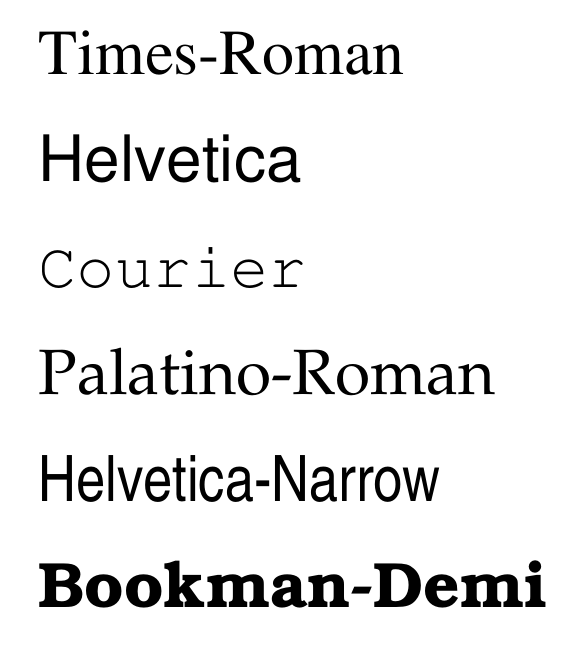

Local SVG with transparency, colored shapes, and text:


Reference image:


[local-picture]: MarkdownFeatures.svg "Reference SVG title"

Linked image:

[](https://example.com)

- Image inside a list: 

> Image inside a quote: 

**Image inside emphasis: **

### Optional online image checks

These two images require internet access; loading must not freeze the editor.  
An offline failure should leave a readable fallback and preserve the destination.


## 9. Basic HTML

HTML layout, entities, numeric image dimensions, and linked images:

<h1 align="center">Centered HTML heading</h1>

<h2 align="right">Right-aligned HTML heading</h2>

<h3>HTML heading level 3</h3>

<h4>HTML heading level 4</h4>

<h5>HTML heading level 5</h5>

<h6>HTML heading level 6</h6>

<p align="left">Left-aligned paragraph with <strong>strong</strong>, <b>bold</b>, <em>emphasis</em>, <i>italic</i>, and a <span>plain span</span>.</p>

<p align="center">Centered paragraph: A &amp; B &lt; C &gt; D.<br/>A second line after an HTML break.</p>

<p align="right">Right-aligned paragraph with an <a href="https://example.com?a=1&amp;b=2" target="_blank">HTML link</a>.</p>

<p align="justify">Justified paragraph with enough words to check wrapping and spacing when the editor window becomes narrower. The HTML tags and attributes should survive a save and reload.</p>

<p align="center"><a href="https://example.com"></a></p>

Inline HTML among Markdown: before <strong>bold HTML</strong>, <em>italic HTML</em>,  
<span>a span</span>, and <a href="https://example.com">a link</a><br/>after a break.

## 10. Mermaid: all 24 diagram types

Each labeled example below should render a native image, not its source code.  
No browser, JavaScript runtime, or network connection is needed for diagrams.  
Switch to plain text mode to inspect or edit their fenced source.

FIND-BEFORE: text immediately before the first diagram.

### 10.1 Flowchart

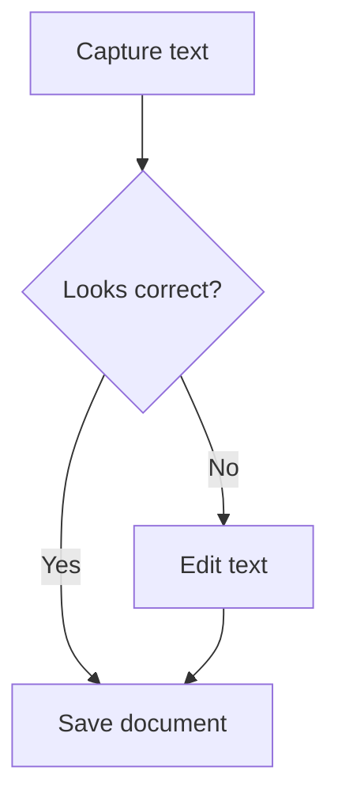

FIND-AFTER: text immediately after the first diagram, including **FIND-LAST**.

### 10.2 Sequence

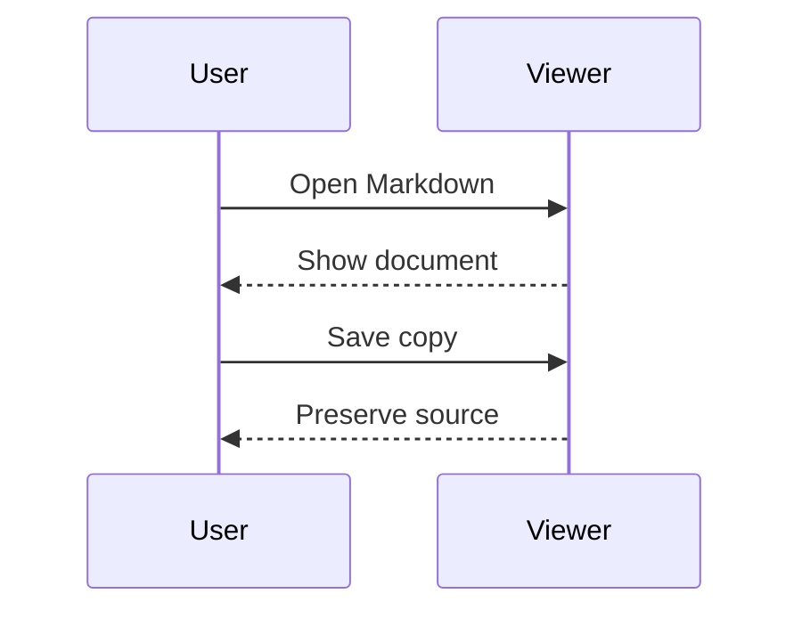

### 10.3 State

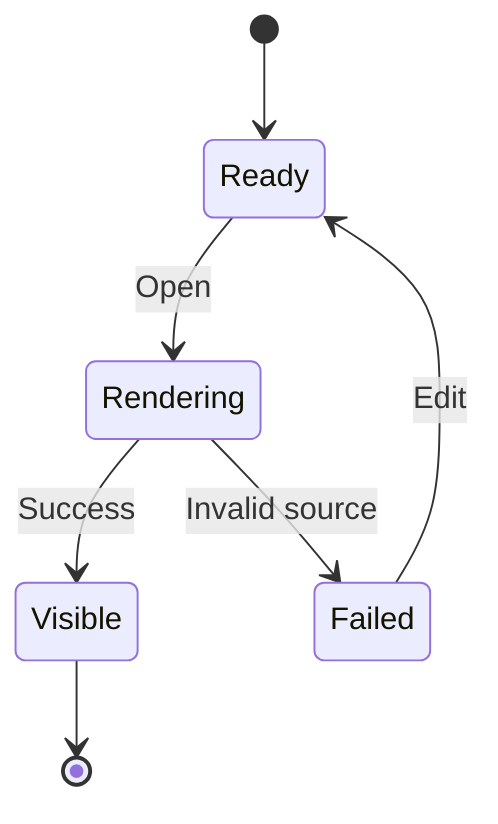

### 10.4 Class

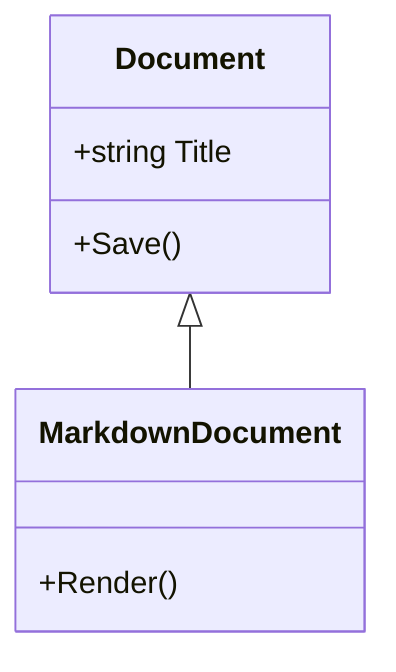

### 10.5 Entity relationship

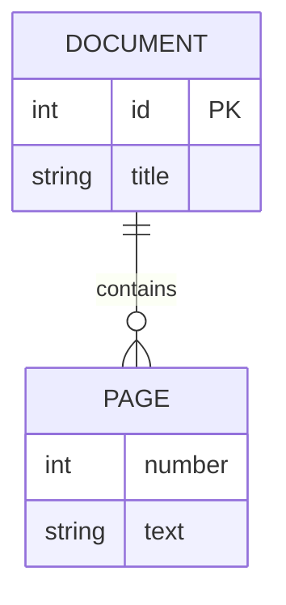

### 10.6 Pie

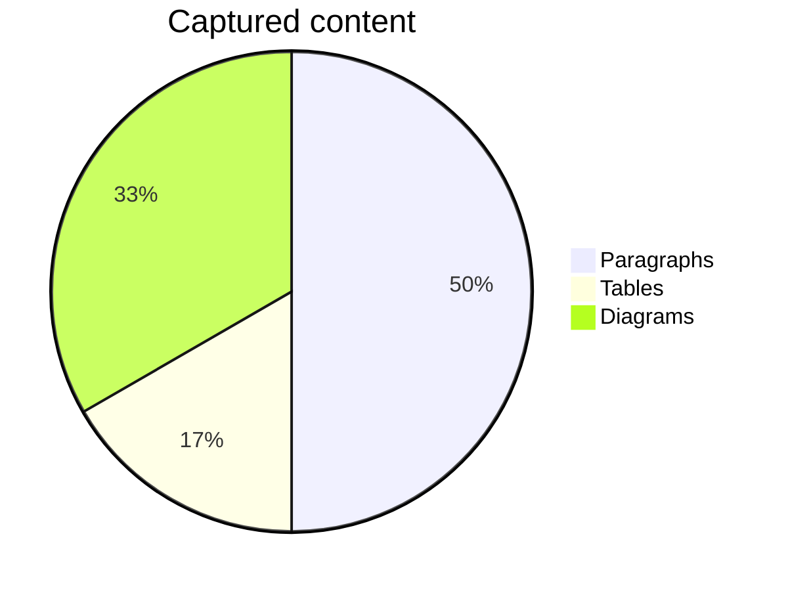

### 10.7 Quadrant

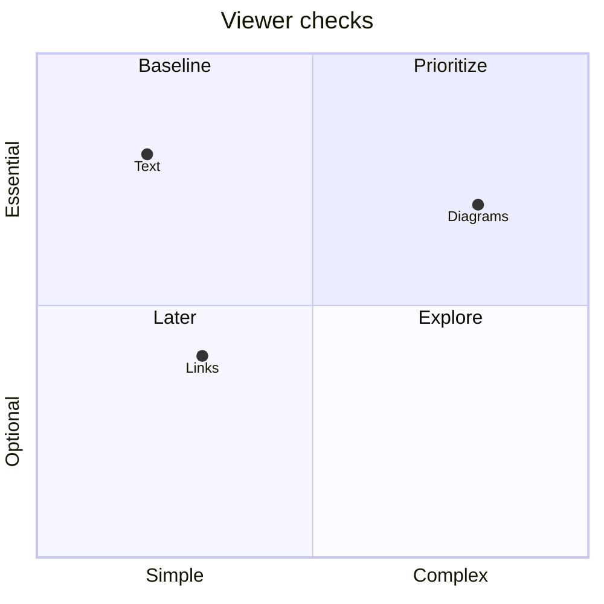

### 10.8 Timeline

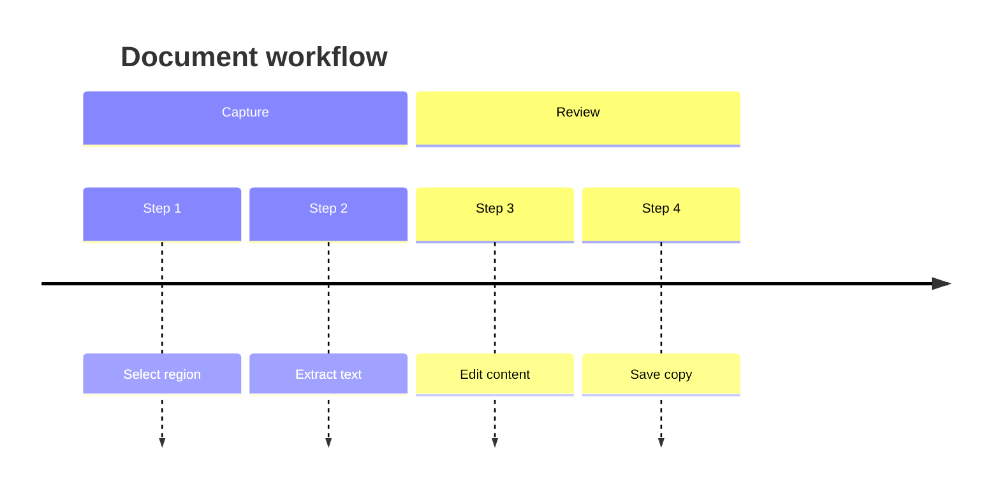

### 10.9 Git graph

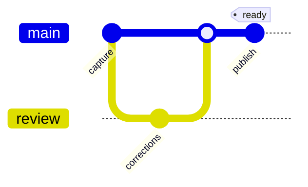

### 10.10 Radar

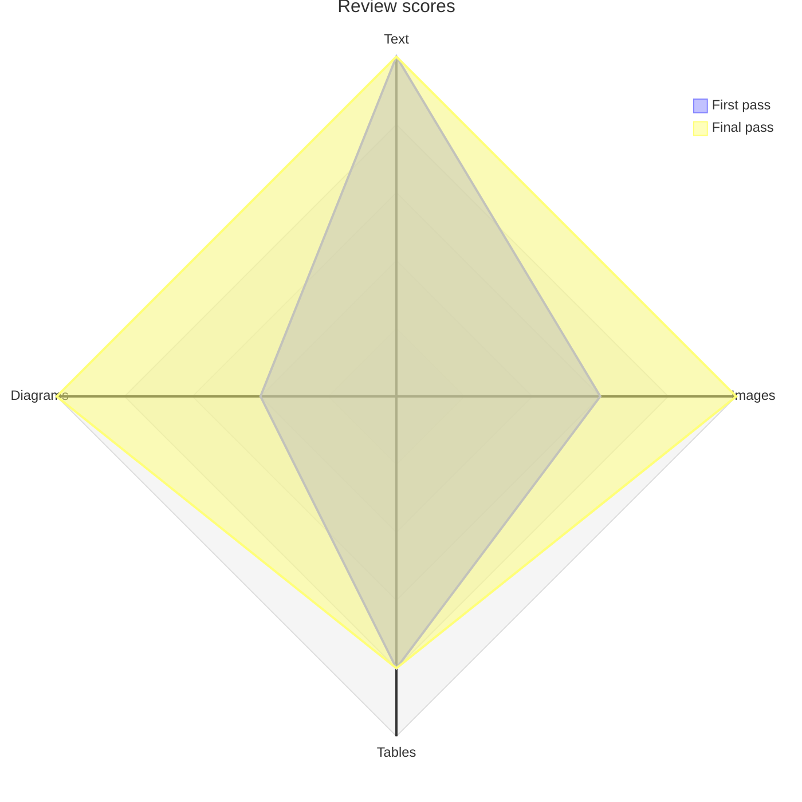

### 10.11 Treemap

```mermaid
treemap-beta
  "Text": 60
  "Images": 25
  "Diagrams": 15
```

### 10.12 Venn

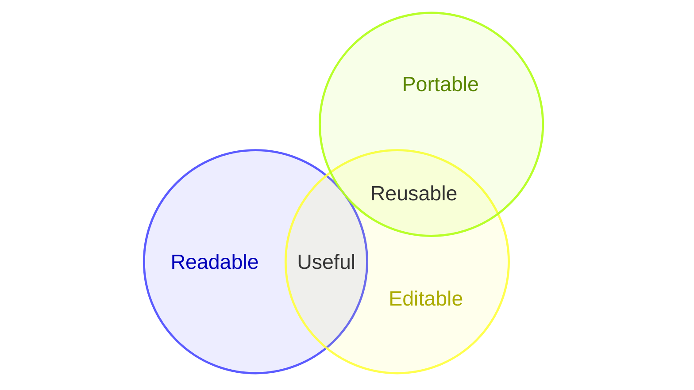

### 10.13 Mindmap

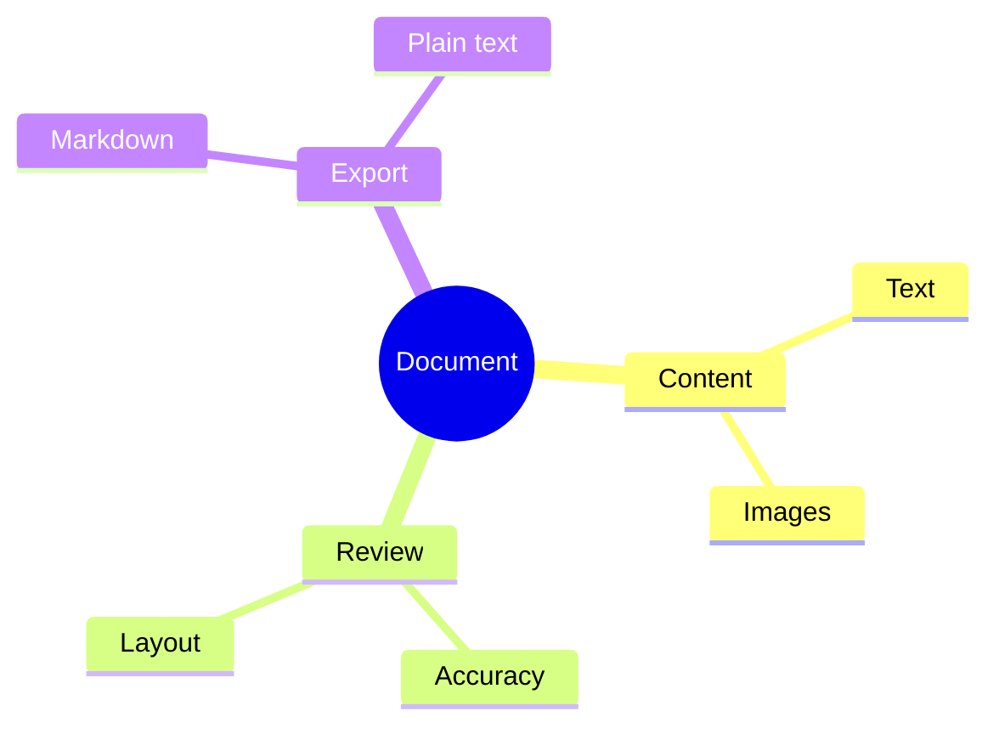

### 10.14 Gantt

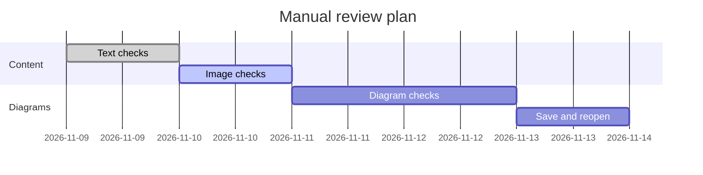

### 10.15 User journey

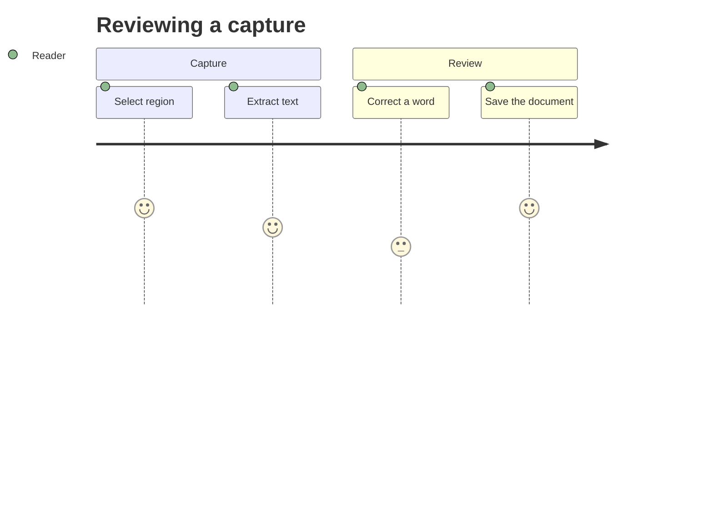

### 10.16 C4 context

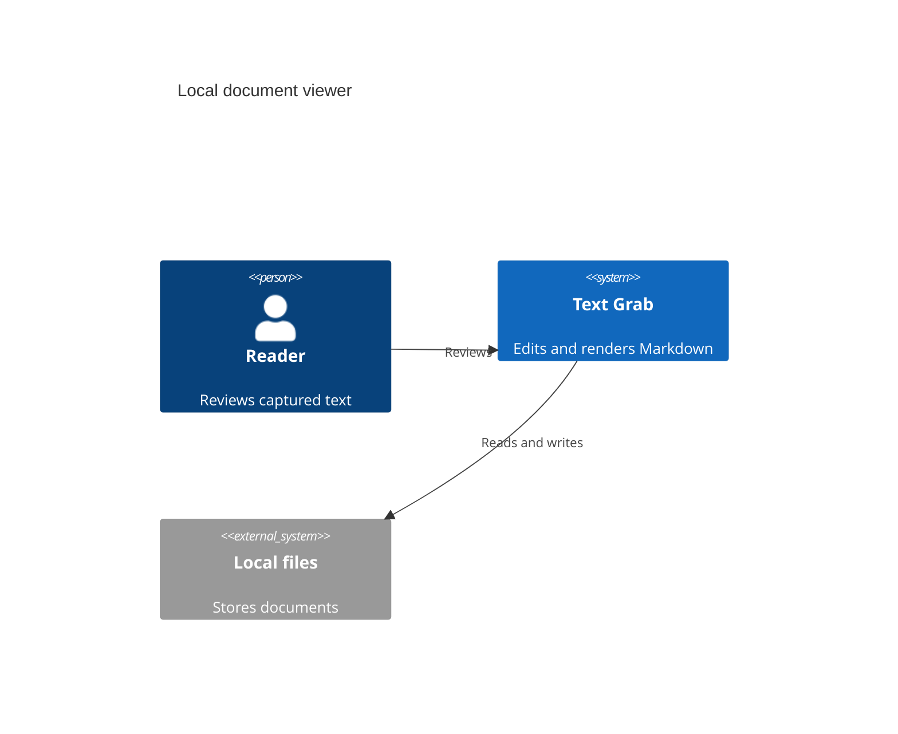

### 10.17 Sankey

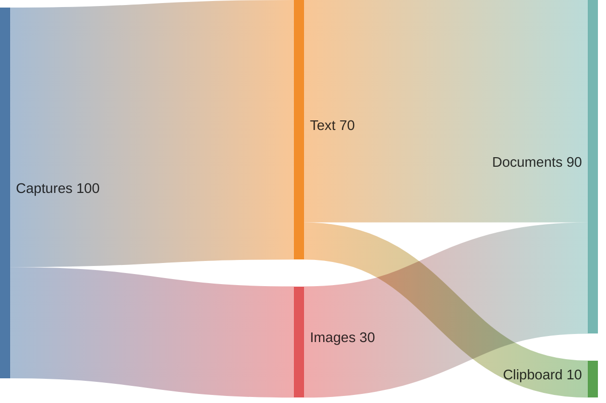

### 10.18 XY chart

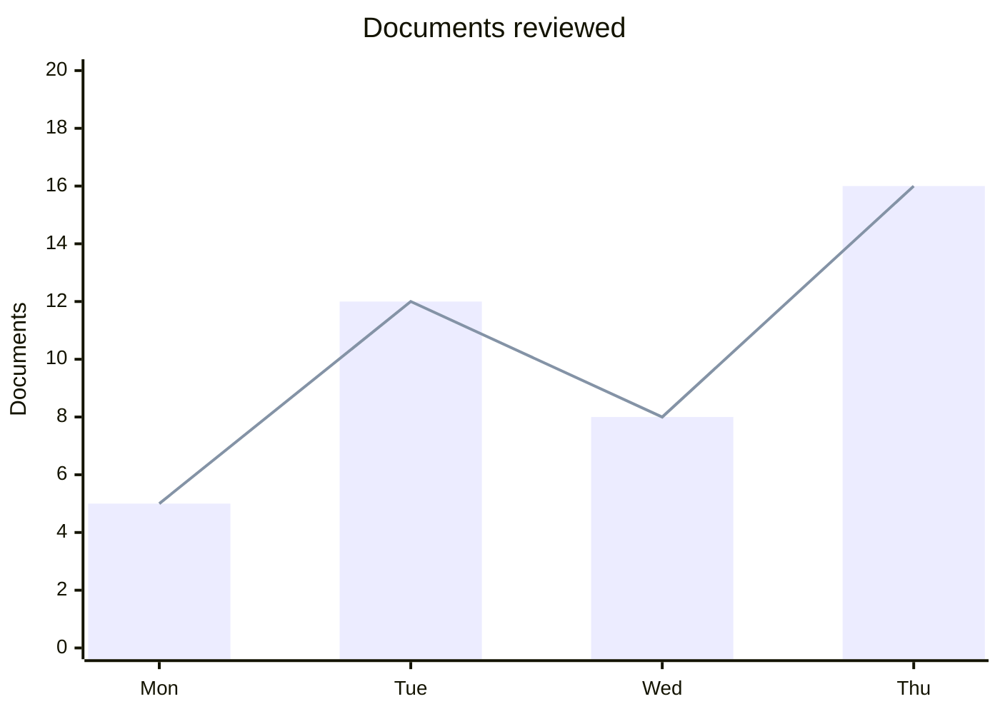

### 10.19 Requirement

```mermaid
requirementDiagram
  requirement preserve_source {
    id: 1
    text: Keep diagram source when saving.
    risk: medium
    verifymethod: test
  }
  element roundtrip_check {
    type: test
  }
  roundtrip_check - satisfies -> preserve_source
```

### 10.20 Packet

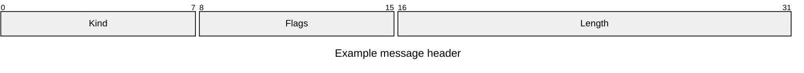

### 10.21 Kanban

```mermaid
kanban
  Todo
    Check images
    Check diagrams
  Reviewing
    Check Markdown
  Done
    Open fixture
```

### 10.22 Architecture

```mermaid
architecture-beta
  group desktop(cloud)[Desktop]
  service editor(server)[Editor] in desktop
  service storage(database)[Documents] in desktop
  editor:R -- L:storage
```

### 10.23 Block

```mermaid
block-beta
  columns 3
  capture["Capture"] review["Review"] save["Save"]
  text["Text"] images["Images"] diagrams["Diagrams"]
```

### 10.24 Tree view

```mermaid
treeView-beta
    Documents/
        Notes/
            meeting.md
            tasks.md
        Images/
            capture.png
        index.md
```

## 11. Mermaid in containers and alternate fences

### Quote container and graph keyword alias

> ```mermaid
> graph LR
>   source[Quoted source] --> preview[Quoted preview]
> ```

### List container

- A diagram inside a list item:
  
  ```mermaid
  flowchart LR
    item[List item] --> diagram[Diagram]
  ```

### Uppercase language name and tilde fences

```MERMAID
flowchart LR
  plain[Plain text mode] --> rendered[Markdown mode]
```

## 12. Footnotes

This sentence has a formatted footnote[^viewer-note]. This sentence reuses the  
same note[^viewer-note], and this one has a second note[^second-note].

Ctrl+click each superscript number to jump to its numbered note at the end.  
Ctrl+click each return link to return to the corresponding reference. Check both  
return links on the first note, edit its text, and save and reopen the document.  
The definitions must keep their labels and formatting without copying the gallery.

## 13. Intentional failures and unsupported content

These checks are deliberately not successful rendering examples.

### Missing and blocked images

The missing image should show its source and an explanatory tooltip:


The unsupported URI scheme and network share must not load automatically:


### Invalid Mermaid

The next block should show an error and retain the invalid source when saved:

```mermaid
this is deliberately not a diagram
```

### Unsupported math command

This formula should show an error and keep its source when saved: $\notacommand{x}$.

### Similar language name is ordinary code

```mermaid-example
flowchart LR
  A --> B
```

### Unsupported HTML stays literal

<div>Unsupported HTML layout should remain visible as source.</div>

## End of gallery

After saving and reopening a copy, recheck a local image, an HTML linked image,  
a table, a nested diagram, and the intentional Mermaid error. All Mermaid source  
must still be present in plain text mode.

[^viewer-note]: A **formatted footnote** with a [link](https://example.com) and `inline code`.
    
    This second paragraph belongs to the same footnote.
    
    - A footnote list item.
    - Another item with *emphasis*.

[^second-note]: A second note, numbered by the order of its first reference.